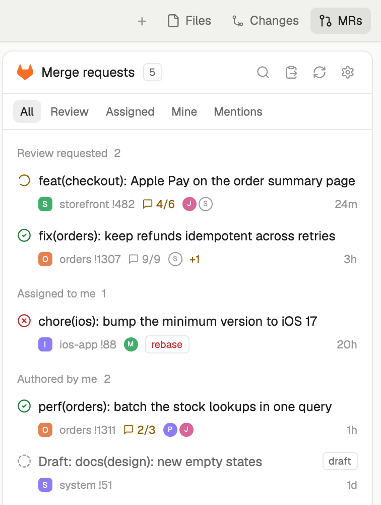

# glab: GitLab merge requests for Herdr

A Herdr layout with a GitLab panel on the right, beside Files and Changes:
every opened merge request that concerns you (review requested, assigned,
authored, mentioning you), its pipeline, review threads and approvers, and
whether a space has it checked out. Open one to read and resolve its threads,
check it out into a worktree space, or review it in
[tuicr](https://tuicr.dev).



<sub>The preview runs the real panel over invented merge requests.</sub>

## Requirements

- The Herdr app, macOS. The layout is a copy of Herdr's `main` layout
  (version in `cloned_from` in `layouts/glab.json`); later changes to `main`
  don't reach it.
- A GitLab personal access token with the `api` scope, on GitLab.com or a
  self-managed instance.
- [agents-menu](../agents-menu/): the layout's agents list.
- `git`, `curl`.
- Optional: `tuicr` for Review, which itself needs the `glab` CLI.

## Install

Ask an agent in Herdr to add `https://github.com/hlouis/herdr-mod/tree/main/glab`.
By hand:

```sh
cp layouts/glab.json layouts/glab.svg ~/.config/herdr-app/layouts/
cp -R mods/glab mods/glab-tabs ~/.config/herdr-app/mods/
cp -R ../agents-menu/mods/agents-menu ~/.config/herdr-app/mods/
# merge keys.json into ~/.config/herdr-app/keys.json
herdr-app do layout.switch --name glab
```

`ctrl-shift-l` (`cmd-shift-l` on the default macOS keys) switches back to your
previous layout; deleting the copied files removes it.

## Set up

Open the panel with the **MRs** button or `cmd-shift-m`. The first time, it
asks for your GitLab: pick GitLab.com or enter your instance's URL, follow
"Create a token" (the `api` scope comes pre-filled), paste the token and
Connect. The connection is saved to `~/.config/herdr-app/glab.json`, readable
only by you; the gear in the panel's header changes or removes it.

## Use

Click an MR for its details and threads; hover a row for check out, review and
open in the browser. The panel takes the keyboard when clicked: `j`/`k` move,
`enter` opens, `esc` goes back, `/` searches, `tab` filters, `R` refreshes,
`v` opens the MR whose link is on the clipboard. The full behaviour, and how
it is built, is in [RECIPE.md](RECIPE.md).
