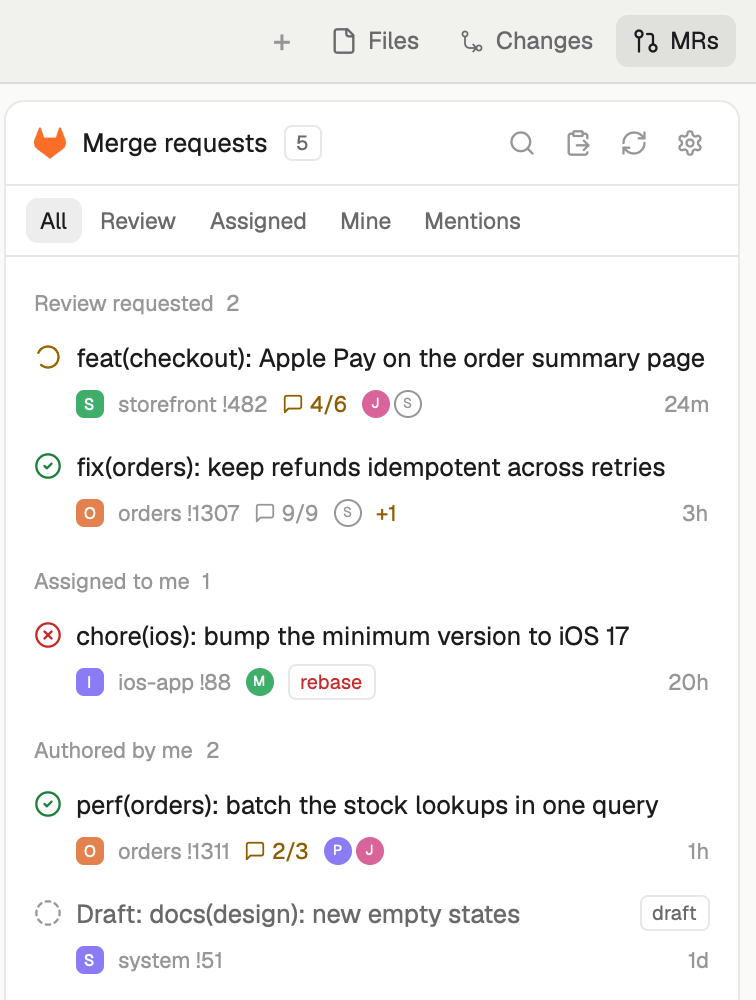

# GitLab MRs

A side panel of every opened GitLab merge request that concerns you: asked to
review, assigned, authored, or mentioning you. It sits on the right beside
Files and Changes, opened from an **MRs** button in the tab bar. Each MR shows
its pipeline, review threads, approvers and whether a space has it checked out;
click one for its details, its review threads (resolve or reopen them) and
actions: check it out into a worktree space, review it in tuicr, open it in the
browser. It talks to GitLab.com or a self-managed GitLab with a personal access
token, no CLI needed.

The preview runs the real panel over invented merge requests.

## What you see

The `glab` layout is Herdr's `main` layout with two changes: the tab bar has an
**MRs** button after Files and Changes (git-pull-request icon, 14px), and the
right panel (368px, 280 to 900) has a third child, the MR panel.

The panel is a card like Changes: 10px corners, `background` fill, 1px
`border`, 13px text.

- **Header**, 42px, 14px side padding: the GitLab tanuki in `#FC6D26` (16px),
  "Merge requests" semibold, a count chip (10px text, 1px `border`, 4px
  corners), then icon buttons (14px icon, 3px padding, `dim`, `hover` fill,
  tooltips): search, open from clipboard, refresh (tinted `working` while
  fetching), settings (gear). Not connected: only the gear.
- **Error strip** (only after a failed fetch): 11.5px `ansi1` text across the
  panel; when the token was refused, a "Settings" link at its right in
  `accent`.
- **Filters**, under the header: All, Review, Assigned, Mine, Mentions; 11.5px,
  6px corners, the chosen one on `selected`.
- **Search field** (only while searching or filtered): 30px, 8px corners,
  `accent` border while typing, a search icon.
- **List**: groups in this order, each MR once, under the first that applies:
  Review requested, Assigned to me, Authored by me, Mentioning me. A group
  heading is 30px, 11px medium `dim`, title and count. Inside a group: newest
  first, drafts last.
- **An MR row**, two lines, 6px × 8px padding, 8px corners:
  1. Pipeline icon (14px), then the title (12.8px, truncated; `muted` for a
     draft, with a "draft" chip).
  2. Indented 21px, 11px `dim`: project tile (14px), `<project> !<iid>`,
     threads (message icon + resolved/total, `ansi3` while any is open),
     approver avatars (14px; who approved filled, who still owes a review as an
     outlined circle), `+N` approvals still required in `ansi3`, a `rebase` or
     `conflict` chip in `ansi1`, a local mark, and the age (`24m`, `3h`, `1d`)
     at the right.
- **Pipeline icons**: success `circle-check` `ansi2`; failed `circle-x`
  `ansi1`; running `loader-circle` `working`, turning once a second; pending,
  created, scheduled, waiting `clock` `dim`; canceled, skipped `circle-slash`
  `dim`; manual `hand` `dim`; no pipeline a dashed circle `dim`.
- **Local mark**: `git-branch` in `accent` when a space has the MR's branch
  checked out; `folder-git-2` `dim` when a space has the repository only;
  nothing otherwise.
- **People** are initials on a circle; **projects** are a 4px-cornered tile
  with the name's first letter, or the project's own avatar when it has one.
  Both pick their color from the name: `#22a99a`, `#e3814f`, `#5b8def`,
  `#8b7cf6`, `#3fae6a`, `#d9649a`, white letters.
- **Detail page** (click an MR): a 36px bar with back, `<project> !<iid>`,
  copy link and open in browser; then the title (15px semibold, wrapping),
  project, `source → target` branch, chips for each reason it concerns you,
  author and age, pipeline (with the rebase/conflict chip); buttons: **Check
  out** (filled `solid`) or **Open space** when it's checked out, and
  **Review** (outlined); **Approvals**: one 26px row per person, avatar 18px,
  ✓ approved in `ansi2` or a clock and "pending"; **Threads** "n/m resolved":
  open threads first, resolved ones folded under "Resolved n" (shown at once
  when nothing is open). A thread row: resolved ✓ `ansi2` or message icon
  `ansi3`, first author's avatar, `file:line` or "Overall", note count, age,
  and its first line; expanded, every note with author, age and its body as
  markdown, and a **Resolve** / **Reopen** button.
- **Settings page** (gear): "Connect to GitLab" with a line of explanation when
  not connected, else a back bar and "✓ Connected as <user>" with the host;
  INSTANCE as two radio rows in a bordered box, GitLab.com and Self-managed
  (its URL field shows only when chosen); ACCESS TOKEN as a masked field, a
  note that it needs the `api` scope, and a "Create a token on <host>" link in
  `accent`; **Connect** (filled), **Disconnect** when connected; errors in
  `ansi1` under the buttons; a footnote naming the file it saves to.

## How it behaves

- **Opening**: the MRs button or `cmd-shift-m` (`glab-tabs.mrs`) toggles the
  panel. Like Files and Changes, each space remembers whether it was open.
- **Data**: fetched when the panel starts, every 5 minutes (also while
  hidden), on refresh (`R` or the button) and after a thread is resolved or
  reopened. The last fetch is kept in shared state, so the panel shows it at
  once and keeps it, marked by the error strip, when a fetch fails. Threads
  are fetched when a detail page opens.
- **Clicks**: an MR row opens its detail page; a group heading folds it; a
  filter chip filters. Hovering an MR row swaps its age for three buttons:
  check out (or go to its space), review, open in browser.
- **Keys** (the panel takes the keyboard when clicked, or by `pane.go`):
  list: `j`/`k` or arrows move (the row scrolls into view), `enter`/`l` opens
  the detail, `tab`/`shift-tab` cycle filters, `/` searches title, project
  and branch (`esc` clears, `enter` keeps it), `v` opens the MR whose link is
  on the clipboard, `R` refreshes; anywhere: `c` checkout, `r` review, `g` go
  to its space, `o`/`b` browser, `y` copy link. Detail: `j`/`k` move between
  threads, `enter` expands, `R` resolves or reopens, `esc`/`h` goes back.
  Settings: every key goes to the fields; `esc` goes back when connected.
  The keyboard's row is filled `selected` only while the panel has the
  keyboard.
- **Check out**: needs a local space with a checkout of the project (the
  detail page's button is disabled with a tooltip otherwise; the key and the
  hover button toast why). Reuses a worktree that already
  has the branch (selects its space, or opens one); else fetches the source
  branch, creates a local tracking branch, and hands it to Herdr's `worktree`
  mod, which adds `~/.herdr/worktrees/<repo>/<branch>` and opens an unnamed
  space there (it nests under the repository's). A fork's MR is fetched as
  `mr/<iid>` from `refs/merge-requests/<iid>/head`.
- **Review**: a new tab named `review !<iid>` in the repository's space (else
  the current one) running `tuicr mr <url>`.
- **Go to its space**: selects the space whose checkout is on the MR's branch.
- **Results**: errors and confirmations ("Link copied", "Thread resolved",
  "Connected to GitLab") are Herdr toasts.
- **Connect**: checks the token by asking who it signs in as; only then saves
  `{ url, token }` and fetches. Disconnect deletes the file and clears the
  list.

## Built from

- `layouts/glab.json`: a clone of `main` (`layout.clone`) whose `tabs` block
  shows `glab-tabs` and whose `panel-body` stack gets
  `{ "id": "glab", "content": { "mod": "glab" } }`. Root `preview` is
  `layouts/glab.svg`.
- `mods/glab-tabs`: a clone of the shipped `tabs` (`mod.clone`). It adds the
  MRs panel button (always offered, whatever `workspace.panels` says), a
  `toggle(id)` the buttons share, and a `nextCommand` loop that toggles the MR
  panel on `mrs`.
- `mods/glab` (`mod.json`: `place: none`, `focusable: true`):
  - `main.js`: state, refresh, keys, page switching.
  - `list.js`, `detail.js`, `settings.js`: the three pages.
  - `ui.js`: icons, avatars, pipeline marks, chips, buttons, and a scroller.
  - `gitlab.js`: GraphQL over `fetch` (`POST <url>/api/graphql`,
    `Authorization: Bearer`): the authored, review-requested and assigned
    lists in one paged query, mention todos for "Mentioning me", one MR by
    project and iid, discussions, `discussionToggleResolve`.
  - `config.js`: `~/.config/herdr-app/glab.json`.
  - `repo.js`: each local space's checkout (first terminal's folder): top
    level, linked or not, branch, remotes on the connected host.
  - `actions.js`: jump, checkout, review, browser, copy, clipboard.
  - `icons/`: lucide-static 0.460.0 (ISC); `gitlab.svg`: the Simple Icons
    tanuki filled `#FC6D26`.
- Herdr: `spaces`, `panes`, `shared`/`setShared` (`glab.mrs`), `notify`,
  `run` (`space.select`, `space.new`, `tab.new`), `openOverlay` (the shipped
  `worktree` mod), `hc` (`exec git`), `exec`, `fetch`, `readTextFile`,
  `fs/promises`.
- Programs: `git` (through herdr-core), `curl`, `open`, `pbcopy`, `pbpaste`,
  `tuicr` (Review only; tuicr itself needs `glab`).
- Keys: `keys.json` binds `cmd-shift-m` to `glab-tabs.mrs`.

## Watch out

- Rows of `v_virtual_list` and `list` take no handlers, and `list` keeps each
  item as first drawn under its key. Hover buttons and tooltips need plain
  rows, so the panel scrolls its own column: rows report their height through
  `on_size_change`, which also lets the keyboard bring a row into view.
- A click handler that changes state must `cx.notify()`, or nothing redraws
  (a back button that "does nothing").
- `fetch` returns text or JSON only. Project avatars (binary) are downloaded by
  `curl`, the token piped from the config file into `-H @-` so it never sits
  on a command line.
- People's avatars live under `/uploads/`, which GitLab serves only to a
  signed-in browser: a token gets 401. Projects have an API route
  (`/api/v4/projects/:id/avatar`).
- Run `git` through `hc exec`. The app's own process can be refused files an
  ssh config includes (1Password's agent config is in another app's Group
  Container), which breaks `git fetch` over ssh.
- The shipped `worktree` mod creates a missing branch from HEAD: create the
  tracking branch first so it checks out the MR's.
- A hidden panel's mod doesn't get `<mod>.<command>`; the always-shown tab bar
  takes the key and toggles the panel.
- Create the token file mode 600 before writing to it; writing an existing
  file keeps its mode. Keep it out of the mod folder, where syncs and commits
  would reach it.
- The `api` scope is needed: resolving a thread writes.
- Limits: spaces on this computer only; macOS (`open`, `pbcopy`, `pbpaste`);
  one GitLab at a time; 50 MRs a page per list (paged through); threads come
  20 at a time with 20 notes each.
- The cloned layout and tab bar don't follow Herdr's updates to `main` and
  `tabs`.
- `herdr-app shot` returns the last frame: when the window is covered, Herdr
  draws nothing new and the shot is stale.

## Done when

- `herdr-app check` passes for `mods/glab` and `mods/glab-tabs`, and
  `layout.switch {name: "glab"}` shows the MRs button after Changes.
- With no `~/.config/herdr-app/glab.json`, the panel opens on "Connect to
  GitLab"; a bad token shows the refusal under Connect and saves nothing; a
  good one saves the file as `-rw-------` and shows the list.
- The list matches the MRs GitLab shows you, grouped as above, with each
  pipeline's icon (a dashed circle when there is none).
- `cmd-shift-m` toggles the panel; `j`/`k` move the filled row; `enter` opens
  the detail and `esc` comes back; the back button does too.
- An MR with threads shows them open-first; expanding one renders its
  markdown; Resolve flips it and the count on the list follows.
- Check out on an MR whose project has a local checkout opens a worktree space
  on its branch, and its row's mark turns into the branch icon.
- Copy link puts the URL on the clipboard and toasts "Link copied"; `v` with
  an MR link on the clipboard opens that MR, even one that isn't yours.
